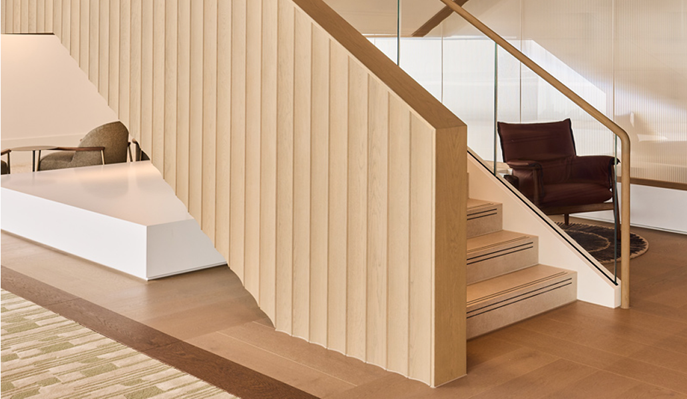

## Step One: The Design Challenge

Combining natural materiality and contemporary design with fire-safe functionality relies on a variety of expertise. CLT structures require precise dimensional coordination to ensure integration with surrounding finishes and the existing building fabric, while maintaining the clean aesthetic envisioned by the design team.

Successful delivery relies on the design being fit for purpose with early collaboration between architectural design teams, structural engineers, timber specialists, MEP consultants and fire engineers.

## Step Two: Manufacturing The Design

Detailed design reviews and coordination sessions are an essential part of resolving key interfaces before manufacturing the product.

These reviews should include:
- Confirming structural load paths
- Coordinating entrances and service interfaces
- Managing tolerances between the CLT and surrounding construction
- Aligning the installation sequence with the wider programme
- Addressing health and safety requirements during design development
Resolving these issues before assembly gives the team greater certainty on site and reduces the risk of delays during installation.

## The Final Step: Installation

Once all your CLT elements have been delivered, the installation team can begin assembly.
The prefabricated nature of the CLT structure provides several advantages:
- Reduced installation time
- High levels of dimensional accuracy
- Better quality control
- A reduction in site waste
To capture this significant project milestone, I’d advise installing a time-lapse camera for the duration of the works. The footage documenting the transformation from individual timber components to a fully formed architectural staircase makes for a compelling watch for your client.